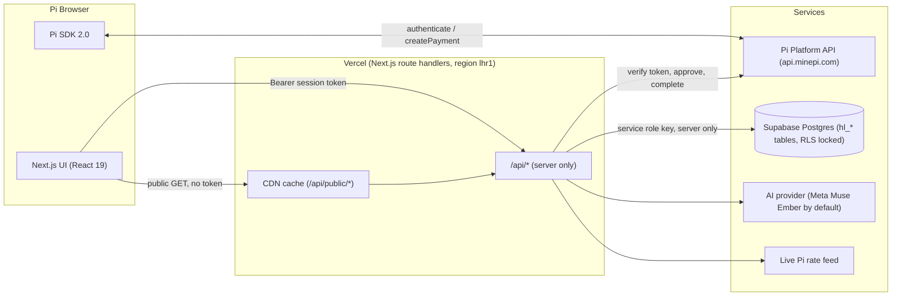
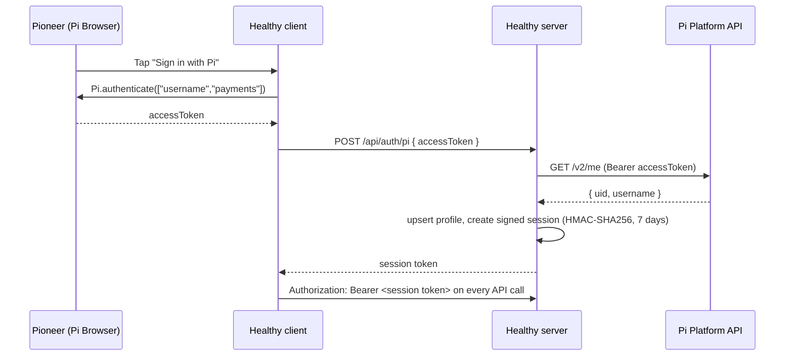
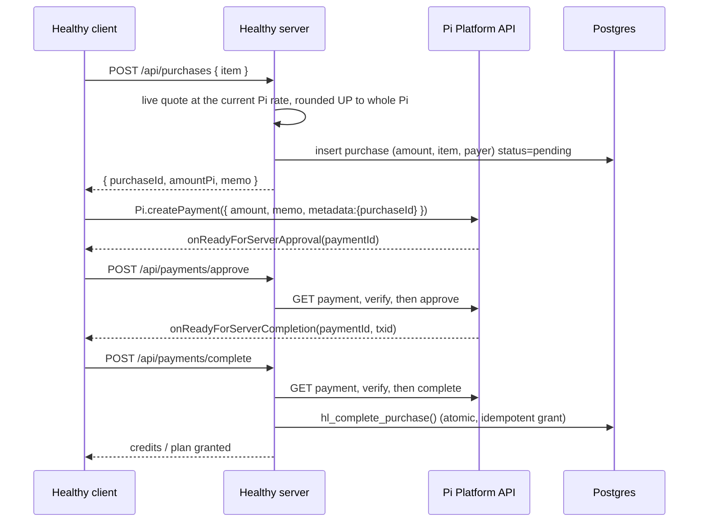

# Healthy

**Daily health challenges, healthy budget meals, personal diet plans and an AI assistant, built for Pi Network Pioneers.**

Healthy turns healthy living into a small daily habit: three short challenges a day, a streak, a catalogue of 110 affordable meals (Egyptian and international), a weekly diet plan that adapts to the user's weight, and **Healthy AI**, which creates a meal, a workout, a 7-day challenge, or analyses a meal photo on demand. Pioneers sign in with their Pi account and pay for AI requests in Pi (user-to-app payments only).

- Live app (Pi Mainnet): <https://healthy-ai-app.vercel.app>
- Languages: English (default) and Arabic with full RTL support
- License: [PiOS](./LICENSE) (Pi Open Source)

> Pi, Pi Network and the Pi logo are trademarks of the Pi Community Company.

---

## Table of contents

1. [Features](#features)
2. [Architecture](#architecture)
3. [Pi Network integration](#pi-network-integration)
   - [Sign-in with Pi](#sign-in-with-pi)
   - [Payments with Pi](#payments-with-pi)
4. [Healthy AI](#healthy-ai)
5. [Data model and credits](#data-model-and-credits)
6. [Security](#security)
7. [Performance and scalability](#performance-and-scalability)
8. [Project structure](#project-structure)
9. [Getting started](#getting-started)
10. [Configuration](#configuration)
11. [Testing and CI](#testing-and-ci)
12. [Deployment](#deployment)
13. [Open source (PiOS)](#open-source-pios)
14. [Roadmap and known limitations](#roadmap-and-known-limitations)

---

## Features

| Area | What it does |
|---|---|
| **Daily challenges** | Three short challenges per day, one free swap, instant check-off, streak and reputation badges (7, 30 and 100-day streaks, sugar-free, water, walking, group challenge). |
| **Food diary** | "My day": log meals from the catalogue, from a photo analysis or manually; calories and protein against the daily goal. Catalogue/AI items are resolved on the server. |
| **Streak protection** | One missed day is forgiven automatically (a "freeze" that recharges after 7 days). |
| **Meal catalogue** | 110 meals (breakfast, lunch, dinner), Egyptian and international, with calories, protein, ingredients and steps. Filters by cuisine, type and health tags. |
| **"I have these ingredients"** | Pick what is in the kitchen and see meals that are ready now, then meals missing one or two items. Free, no credits. |
| **Healthy AI** | Meal, workout, 7-day challenge and **photo analysis** (calorie and protein estimate with ranges). One credit per request, refunded automatically on failure. |
| **Diet plan** | Weekly plan from weight, height, age, goal, activity and declared conditions. Weekly adjustment from logged weight. Water and shopping list. |
| **Progress** | Weight log, habit log, weekly report, and a shareable weekly card drawn on the device (no health data on it). |
| **Community** | 7-day challenge with a friend (invite link), weekly group challenge, weekly and monthly leaderboards, two teams, shared recipes with likes and saves, referrals. Reputation and badges only. |
| **Wallet** | Credit balance, plan expiry, purchase history. |
| **Admin** | Statistics, AI cost per request type, challenge and meal management, audit log. |

Product rules: general nutrition guidance only (no diagnosis, treatment, medication, supplements or fasting advice), no health data on public surfaces, and no prizes or fees in Pi in the community features.

## Architecture



- **Next.js 16 (App Router), TypeScript, Tailwind CSS v4.** Route handlers are the only backend.
- **The browser never talks to the database.** All tables have row-level security enabled with no policies and anonymous privileges revoked; only the server uses the service-role key.
- **Server trust model.** The client is untrusted: prices, amounts, identities, timezones and credit balances are all decided on the server.
- **Public vs private API.** Data identical for every visitor is served from `/api/public/*` with CDN cache headers; everything user-specific is private and never cached.

## Pi Network integration

### Sign-in with Pi



- The Pi access token is verified **server-side** against `https://api.minepi.com/v2/me`; the client's claimed username is never trusted.
- The server issues its own HMAC-SHA256 session token bound to the Pi `uid`. Sessions are **revocable** (`token_version`), and signing out invalidates the token on the server.
- A recycled username with a different `uid` is refused.
- Pi's Platform API exposes **no KYC status** (`/me` returns only the app-specific uid, username and scopes), so Healthy does not gate on KYC. Every Pi-authenticated user is eligible; abuse is limited by real-streak requirements for free credits, capped referral rewards, per-user and global AI caps, and real Pi payments. `PI_KYC_MODE=strict` re-enables a flag check if Pi ever provides one.
- The `payments` scope is requested at sign-in so the Pi SDK can start payments; incomplete payments from earlier sessions are recovered automatically.

### Pi Sign-In outside Pi Browser (OAuth)

On an ordinary browser (for example the installed web app), the sign-in button starts **Pi Sign-In** (OAuth implicit flow): the user is sent to `accounts.pinet.com/oauth/authorize` with the app's public client id and a random `state`; Pi returns an access token in the URL fragment to `/signin/callback`, which checks the `state`, removes the token from the address bar and sends it to `POST /api/auth/pi`. The server verifies it with the Pi API exactly like an in-app token, so nothing is trusted on the client. Payments still require Pi Browser (Pi Wallet).

Register these redirect URIs in Pi Developers: `https://<your-domain>/signin/callback` (and `http://localhost:3000/signin/callback` for local work). The domain must be verified with `validation-key.txt`.

### Payments with Pi

Healthy uses **user-to-app (U2A) payments only**. There is no escrow, no app-to-user payout, no transfer between users and no auto-renewal.



Verification (`src/server/payment-verify.ts`) checks, against the **purchase row stored on the server**, never against client input:

- the amount equals the server-quoted amount, the item and memo match, and the payment is `user_to_app`;
- the payer's Pi `uid` is the purchase owner;
- the payment is not cancelled and the transaction is verified;
- the Pi payment id is unique (database unique index), so a payment can never be replayed against another purchase.

The grant is a single SQL transaction (`hl_complete_purchase`) that takes a per-purchase lock, so concurrent completions cannot grant twice. Recovery is built in: `reconcileOne` for stuck payments, `/api/payments/incomplete` for payments left open by the SDK, and a daily cron job.

Plans and packs:

| Item | Grants |
|---|---|
| Monthly plan | 40 AI requests, valid 30 days (renewal locked while active) |
| Small pack | 10 AI requests |
| Large pack | 30 AI requests |

The price is quoted in Pi by the server at purchase time and shown in the app before the Pioneer confirms. Definitions live in `src/config/pricing.ts`; `PRICING_MODE=fixed` switches to fixed Pi amounts for Testnet.

## Reminders at your own hour

Each person chooses a reminder hour in their profile (default 17:00 local time). An hourly **database scheduler** (Supabase `pg_cron` + `pg_net`, see [`supabase/scheduler.sql`](./supabase/scheduler.sql)) calls `/api/cron/reminders` with a dedicated `SCHEDULER_SECRET`; Vercel Cron remains as a daily fallback. The SQL function `hl_claim_reminders` atomically claims people whose local hour is now and who have not done a challenge, so overlapping or repeated runs can never send twice. Plans ending within 3 days get one notice per expiry date (`hl_claim_expiry_notices`). Delivery uses the Pi Notification Center and Web Push, both with high priority.

## Installable app and reminders (PWA)

Healthy is an installable web app (manifest, icons, service worker). In a regular browser users can add it to the home screen and turn on a **daily reminder** (Web Push, VAPID): a daily cron (`/api/cron/reminders`) sends one notification only to people who have not completed a challenge that day in their own timezone. Subscriptions are stored per device in `hl_push_subscriptions` (deleted with the account); the service worker caches nothing. Pi Browser may not support Web Push; the feature simply stays off there.

### Pi Notification Center (in-app notifications)

Inside Pi, Healthy can reach Pioneers through the **Pi Notification Center** (`POST /v2/in_app_notifications/notify`, server API key). At sign-in the app also requests the `in_app_notifications` scope (falling back gracefully if a Pi version does not accept it). The daily job sends one reminder to people active in the last 30 days who have not completed a challenge today; Pi delivers it only to users who consented and have notifications on, and the notification opens `/today`. Limits respected: 256 per request, 48 per user per 24 hours (we send at most one). Users can turn it off in their profile (`notify_pi`).

## Healthy AI

The AI layer is a provider abstraction (`src/server/ai/provider.ts`). Provider, model and key come from environment variables and never reach the client. Default: **Meta Model API, `muse-ember-1.0`** (`AI_PROVIDER=meta`); `anthropic` and OpenAI-compatible providers are also supported. If no key is configured, the AI features report "not configured" and never fabricate output.

How a request flows (`src/server/chef.ts`):

1. **Guards before any cost:** authentication, health disclaimer accepted, prompt length, safety screening of the request (no diagnosis, treatment, medication, children's diet plans), rate limits (per hour, per day, global circuit breaker) and a single in-flight request per user.
2. **Spend one credit atomically** (`hl_spend_credit`, per-user lock, order: plan, then trial, then pack).
3. **Generate** with strict JSON schemas (zod), a time budget that actually cancels the provider call, web search for unfamiliar dishes and a 30-day cache of identical requests.
4. **Validate the output:** schema, forbidden-content filter (supplements, doses, fasting, cure claims), a **1,200 kcal/day floor**, and consistency checks (calories vs ingredients vs macros) for photo analysis.
5. **Refund automatically** on refusal, timeout, unusable output or any error. A daily job refunds requests left pending by a crashed function.

Photo analysis (`src/server/ai/scan.ts`): the user photographs a meal with the in-app camera; the image is compressed on the device, validated on the server (type, size, **header-parsed dimensions**) and sent to the model only to produce the estimate. **The photo is not stored**; only the text result is saved. Text inside images is treated as data, never as instructions.

Cost control: real token and search usage is recorded per request (for every provider) with an estimated cost, shown in the admin dashboard per request type. The cost per request is very low.

## Data model and credits

All objects are prefixed `hl_`. Migrations are in [`supabase/migrations`](./supabase/migrations) and are applied in order.

| Table | Purpose |
|---|---|
| `hl_profiles` | One row per Pioneer: Pi identity, KYC flag, health profile, language, timezone, session version |
| `hl_challenges`, `hl_user_challenges`, `hl_streaks`, `hl_badges` | Daily challenges, streaks, badges |
| `hl_meals`, `hl_meal_overrides`, `hl_favourites` | Catalogue and favourites |
| `hl_purchases`, `hl_subscriptions` | Pi purchases and plan validity |
| `hl_credit_ledger` | **Append-only** credit ledger; balances are always derived from it |
| `hl_ai_requests`, `hl_recipes`, `hl_ai_cache` | AI requests (with cost), saved results, 30-day cache |
| `hl_diet_plans`, `hl_weight_logs`, `hl_habit_logs`, `hl_weekly_reports` | Plans and progress |
| `hl_group_challenges`, `hl_group_challenge_members`, `hl_group_challenge_checks`, `hl_referrals` | Community |
| `hl_rate_limits`, `hl_admin_audit` | Rate limiter and admin audit trail |

Credits are a **ledger, not a counter**: UPDATE and DELETE on the ledger are blocked by a trigger, spending/refunding run inside functions under a per-user advisory lock, balances can never go negative, and refunds are idempotent. A starter grant of 3 credits is given once per user (unique index).

## Security

Reviewed end to end (payments, AI, privacy, API, database). Highlights:

- **Database perimeter:** RLS on every table with no policies, anonymous privileges revoked, service-role key server-only. Verified: anonymous reads/writes and RPC calls are denied.
- **Auth:** server-verified Pi tokens, revocable HMAC sessions, `uid` binding, constant-time secret comparisons, dev login disabled in production.
- **Payments:** server-side quote, amount/payer/memo/direction verification, unique payment id, atomic idempotent grant, quote age enforced only when opening a payment so a paid payment is always recoverable.
- **Privacy:** health notices (diabetes, hypertension, pregnancy cautions) are stripped from anything shown to other users; public leaderboards show only opted-in Pioneers; account deletion removes personal data while keeping the financial ledger and a minimal tombstone.
- **Abuse and cost controls:** per-endpoint rate limits (Postgres, shared across instances), AI hourly/daily/global caps, in-flight guard, input caps, safe refusal text, image header validation.
- **Web hardening:** CSP, HSTS, `X-Content-Type-Options`, `Referrer-Policy`, `Permissions-Policy` (camera on the same origin only), `noindex` on shared pages and the API.
- **Supply chain:** `npm audit` clean, no secrets in the repository, CI runs typecheck, tests and build on every push.

Known trade-offs are listed under [limitations](#roadmap-and-known-limitations).

## Performance and scalability

- **PostgREST over HTTPS** (supabase-js) means no per-user database connection; hot paths avoid N+1 queries.
- **CDN-cached public API** (`/api/public/meals`, `/api/public/meals/[id]`, `/api/public/community`): identical-for-everyone data is cached at the edge (`s-maxage` + `stale-while-revalidate`); the private overlay (`/api/community/me`, `/api/favourites/ids`) is never cached.
- **SQL aggregation** for leaderboards, team totals and monthly rankings instead of pulling rows into the server.
- **Per-instance memo** with in-flight de-duplication: concurrent requests share one query.
- **Write-free balance reads:** the credit balance function only locks or writes when a plan must be settled.
- **Catalogue cache:** the 110-meal catalogue is cached in memory.
- Region `lhr1`, Vercel Analytics and Speed Insights enabled.

At very high traffic, a paid Supabase tier and Vercel plan are required.

## Project structure

```
src/
  app/                 Next.js routes
    api/               Route handlers (auth, payments, chef, public, community, ...)
    today/ meals/ chef/ plan/ progress/ community/ wallet/ profile/ admin/
    open-source/       PiOS page
    terms/ privacy/ r/[id]/   Legal pages and public shared recipe
  components/          UI (Shell, Landing, MealCard, CameraCapture, ...)
  server/              Server-only logic (auth, payments, credits, AI, community, ...)
    ai/                Provider, prompts, schemas, safety, limits
  lib/                 Client/shared helpers (api client, nutrition, planner, streak, dates)
  data/                Seed meals and challenges (Arabic and English)
  config/pricing.ts    Prices, credits, AI limits
supabase/migrations/   Database schema and functions
tests/                 Logic tests and SQL tests (PGlite)
scripts/               Seed scripts
```

## Getting started

**Requirements:** Node.js 22+, a Supabase project, a Pi Developer app (Testnet), and optionally an AI provider key.

```bash
git clone https://github.com/mohamedgamal2248/Healthy.git
cd Healthy
npm install
cp .env.example .env.local        # fill in the values (see Configuration)
```

1. **Database:** run the files in `supabase/migrations/` in order (SQL editor or Supabase CLI).
2. **Seed data:** `npm run seed` (meals and challenges).
3. **Run:** `npm run dev`.
4. **Pi sign-in** works only inside Pi Browser or the Pi Sandbox. For localhost, set `NEXT_PUBLIC_PI_SANDBOX=true` and point your Pi Developer app's development URL at your local server. For UI-only work, `ALLOW_DEV_LOGIN=true` enables a dev login that is **always disabled in production builds**.
5. **Pi Developer Portal:** set the app URL, verify domain ownership (`validation-key.txt` is served from `public/`), generate an API key and add it as `PI_API_KEY`.

## Configuration

Server secrets are never exposed to the browser. See [`.env.example`](./.env.example) for the complete list.

| Variable | Purpose |
|---|---|
| `NEXT_PUBLIC_PI_NETWORK` | `mainnet` (default). `testnet` disables payments unless `ALLOW_TESTNET_PAYMENTS=true` on a staging copy |
| `NEXT_PUBLIC_PI_SANDBOX` | `true` for Sandbox on localhost |
| `PI_API_KEY` | Pi Platform API key (server only) |
| `NEXT_PUBLIC_PINET_URL` | Public PiNet URL used for shared links |
| `SUPABASE_URL`, `SUPABASE_SERVICE_ROLE_KEY` | Database (server only) |
| `SESSION_SECRET` | 32+ random characters used to sign sessions |
| `ADMIN_USERNAMES` | Comma-separated Pi usernames allowed into `/admin` |
| `AI_PROVIDER`, `AI_MODEL`, `AI_API_KEY`, `AI_BASE_URL`, `AI_REASONING_EFFORT` | AI provider settings |
| `PRICING_MODE`, `PRICE_*` | Live or fixed pricing (see `src/config/pricing.ts`) |
| `AI_LIMIT_PER_HOUR`, `AI_LIMIT_PER_DAY`, `AI_GLOBAL_DAILY_CAP` | AI abuse and cost limits |
| `NEXT_PUBLIC_PI_CLIENT_ID` | Optional override of the public Pi Sign-In client id |
| `VAPID_PUBLIC_KEY`, `VAPID_PRIVATE_KEY`, `VAPID_SUBJECT` | Web Push (daily reminders) |
| `CRON_SECRET` | Authenticates the Vercel Cron jobs |
| `SCHEDULER_SECRET` | Authenticates the hourly database scheduler |

## Testing, monitoring and load

- **Unit and SQL tests** (`npm test`, PGlite) cover logic, credits, reminders, streak freeze, diary rules and the security contract of public routes.
- **E2E smoke tests** (`npm run e2e`, Playwright): read-only checks of the live site (pages, manifest, public API, anonymous 401s, security headers) on a phone and a desktop viewport. A daily workflow runs them.
- **Uptime**: `.github/workflows/uptime.yml` probes `/api/health` every 30 minutes; a failed run emails the repository owner.
- **Load**: `loadtest/k6-public.js` ([k6](https://k6.io)) exercises the public, CDN-cached endpoints (`smoke`, `load`, `spike` profiles). Run it only against a copy you own.
- **Supply chain**: Dependabot, CodeQL and [`SECURITY.md`](./SECURITY.md).
- Fonts are self-hosted at build time (`next/font`), so no third-party font requests.

## Testing and CI

```bash
npm run typecheck   # TypeScript
npm test            # logic tests + SQL tests (credit ledger on PGlite)
npm run build       # production build
```

The suite covers streaks and timezones, planner and nutrition math, payment verification (wrong amount, payer, memo, direction, cancelled, quote age), the credit ledger (spend order, refunds, idempotency, referral rules, team and leaderboard SQL), AI safety filters, photo validation and the public-API contract (no auth, no per-user fields). GitHub Actions runs typecheck, tests and build on every push and pull request.

## Deployment

Deployed on **Vercel** (region `lhr1`) with the Supabase project connected through environment variables. [`vercel.json`](./vercel.json) registers a daily cron (`/api/cron/maintenance`) that reconciles stuck payments, refunds AI requests left pending, cancels dead quotes and prunes caches. The app runs on **Pi Testnet**; switching to Mainnet is an explicit configuration step and requires review of the KYC mode.

## Open source (PiOS)

Healthy is released under the **Pi Open Source (PiOS) license** (see [`LICENSE`](./LICENSE)), the license Pi Network provides for apps built for the Pi ecosystem. It permits copying, modification and derivative works **solely to develop, use and market applications for the official Pi Network**. The license text is included unchanged apart from the copyright line.

- In-app page: `/open-source` (license, tech stack and Pi integration summary)
- Reference: <https://github.com/pi-apps/PiOS>
- Naming follows the PiOS rules: the app is "Healthy" (not "Pi Healthy")
- Required notice: *Pi, Pi Network and the Pi logo are trademarks of the Pi Community Company.*

To list the project in the official PiOS App List, open a pull request on `pi-apps/PiOS` adding a row to `list.md` with the title, description, category, framework and Pi Brainstorm link.

## Roadmap and known limitations

- The session token is stored in `localStorage` (common for Pi Browser apps); it is protected by a strict CSP, but a script-injection bug would expose it.
- The CSP requires `unsafe-inline` for Next.js hydration.
- Photo analysis and recipe generation are **estimates**, not medical advice.
- The legal pages are templates and have not been reviewed by a lawyer.
- Planned: Mainnet readiness review, push-style reminders, richer weekly reports, more meals and challenges, a load test before wide launch.

---

*Healthy provides general nutrition and lifestyle information. It is not a medical service and does not replace a doctor.*
